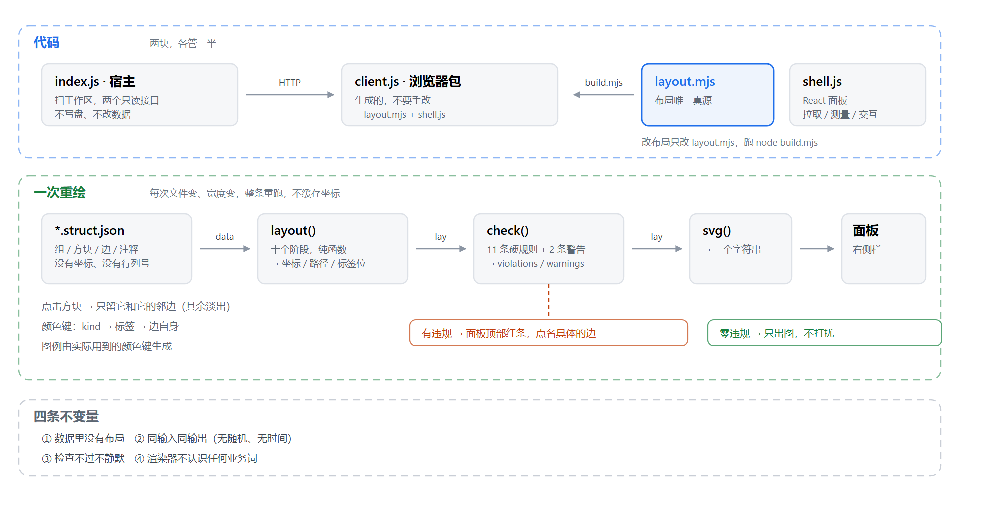
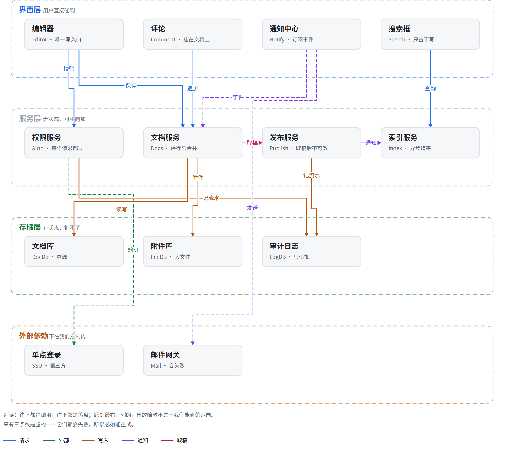

# struct-map

右侧栏里的一张结构图：读工作区里的 `*.struct.json`，把「组 / 方块 / 边」画成图。
数据只描述**有什么、谁指向谁**；坐标、行列、颜色分配、标签位置全部由渲染器每次重算。

> 作者：hdy · MIT



## 长什么样



一个会话型系统的展开：四个组按"用户碰到 / 无状态 / 有状态 / 不受控"分层，颜色是关系类型，虚线是会失败的关系。
图下方两行是判读——**图自己解释自己**，不需要旁边再配一段说明。

> **配套 skill：** 插件是画布，skill 是操作规程（什么时候建图、怎么从方案里提取、怎么增量更新）。
> skill 与插件一起收录在合集的 `skills/struct-map/SKILL.md`。

## 安装

从本地克隆或下载后的合集仓库根目录运行：

```sh
dsh plugin --profile web add "<本仓库绝对路径>/struct-map"
```

安装后刷新页面，右侧栏出现「结构图」标签页。

也可从合集仓库直接安装（需当前 DSH CLI 支持 Git 子目录安装）：

```sh
dsh plugin --profile web add github:moyudamowang/dsh-plugins#path=struct-map
```

本地开发时用 link 安装，改完文件要重装一次：

```sh
plugin_manager remove_bundle @local/struct-map
plugin_manager install_bundle link:<本仓库绝对路径>/struct-map
```

## 它解决什么

实施方案是文字。文字很难说清「这些东西怎么连在一起」，而人的认知是从关系长出来的。
这个插件把方案里的实体关系画成一张图，放在聊天旁边，让人**在实施之前**就能看见系统的形状并确认它。

图和方案的分工：

| | 回答什么 | 谁读 |
| --- | --- | --- |
| 实施方案正文 | 怎么改、按什么顺序改 | 人 + agent |
| **结构图** | **东西长什么样、谁连着谁** | **人** |

## 一句话说清代码分工

| 位置 | 文件 | 职责 | 碰数据吗 |
| --- | --- | --- | --- |
| 宿主 | `index.js` | 扫盘 + 两个只读接口 | 只读 |
| 引擎 | `layout.mjs` | 数据 → 几何 → 违规清单 → SVG 字符串 | 只读，不改传入对象 |
| 界面 | `shell.js` | 拉取、测量宽度、交互、注入 SVG | 只读 |

`client.js` 是**生成的**：`node build.mjs` 把 `layout.mjs`（去掉 `import` / `export` / CLI）和 `shell.js` 拼成浏览器包。
布局代码只有 `layout.mjs` 这一份，不要手改 `client.js`。

## 数据格式

全部字段，没有别的。

```json
{
  "title": "可选：图的名字",
  "groups": [
    { "id": "ui", "title": "界面层", "note": "一句灰字", "tone": "run" }
  ],
  "nodes": [
    { "id": "editor", "group": "ui", "title": "编辑器", "sub": "Editor · 唯一写入口" },
    { "id": "notify", "group": "ui", "title": "通知中心", "sub": "Notify · 订阅事件", "new": true }
  ],
  "edges": [
    { "from": "editor", "to": "auth", "label": "校验", "kind": "请求", "new": true }
  ],
  "notes": ["图下方的一两句话"]
}
```

| 字段 | 必需 | 作用 |
| --- | --- | --- |
| `groups[].id` | ✓ | 分组键 |
| `groups[].title` / `.note` | | 组名 / 组名后的灰字 |
| `groups[].tone` | | 组框配色：`run` `state` `warn` `bad` `plain` |
| `nodes[].id` | ✓ | 方块键 |
| `nodes[].group` | ✓ | 属于哪个组 |
| `nodes[].title` / `.sub` | | 方块第一行 / 第二行小字 |
| `nodes[].new` | | `true` = 本次新增（组色实框）；留空 = 已存在（灰框） |
| `edges[].from` / `.to` | ✓ | 谁指向谁 |
| `edges[].label` | | 线上的字 |
| `edges[].kind` | | 关系分类词，**只当颜色分组用**，渲染器不解释含义 |
| `edges[].dashed` | | 线型开关 |
| `edges[].new` | | `true` = 本次新增的关系（加粗） |
| `notes[]` | | 图下方判读文字 |

**没有**坐标、行列号、层号、排序字段、id 之外的引用。同一份数据换个宽度就是另一张图。

## 数据流

```
宿主 index.js
  ├─ 每 4 秒  GET /struct-map-list          → 工作区里所有 *.struct.json
  └─ 每 2 秒  GET /struct-map-data?file=…   → { ok, data, mtime }

shell.js
  ├─ ResizeObserver 量面板宽度 → avail
  ├─ layout(data, avail)          → lay（坐标 / 路径 / 标签位）
  ├─ check(lay)                   → { violations, warnings, budget }
  └─ svg(lay, 主题, { hi: 选中 }) → <svg> 字符串 → 注入面板
```

宽度变、文件变，整条重跑；不缓存坐标。

## layout()：十个阶段

顺序不可调换，后者依赖前者的产出。

| # | 阶段 | 决定什么 | 规则 |
| --- | --- | --- | --- |
| 1 | 列网格 | `perRow`、`boxW` | **一个组 = 一行**：列数取最大组的方块数；放不下才折行，且不留单块独占一行 |
| 2 | 分行 | 每行 y | 组按数据顺序纵向堆叠，组内按 `perRow` 切片 |
| 3 | 减少交叉 | 行内方块左右顺序 | 按邻居平均 x 排序，上下往返四趟；确定性 |
| 4 | 上色 | 每条边的颜色 | 键 = `kind` → `label` → 边自身；同键同色 |
| 5 | 画布尺寸 | 宽、高、注释区、图例区 | 由内容推出 |
| 6 | 列候选 | 跨行长边可走的竖向通道 | 固定列缝 + 左右两条外通道 |
| 7 | 通道分配 | 每条横线的 y | 先统计每个缝隙需要几条横线，再等距分配；**任何两条横线不共 y** |
| 8 | 端口扇出 | 同一方块侧边多条边的 x | 按对端位置排序后均分，间隔 ≤ 18px |
| 9 | 布线 | 每条边的折线 | 同行相邻=直线；同行隔开=行下绕行；相邻行=缝里一次折；跨多行=一条固定列竖到底 |
| 10 | 贴标签 | 每条标签的坐标 | 落在自己那条线的中点上；被占则沿线滑动、再不行贴到旁边；**永不丢弃** |

## check()：11 条硬规则 + 2 条警告

硬规则命中任一条，`violations` 加一，面板顶部出红条并点名具体的边。

| 规则 | 含义 |
| --- | --- |
| `LINE_THROUGH_BOX` | 线穿过方块 |
| `LINE_IN_FOREIGN_BAND` | 横线穿过不属于它的组 |
| `EDGES_MERGED` | 两条边共线，画成了一条 |
| `LABEL_ON_BOX` | 标签压方块 |
| `LABEL_LABEL` | 标签互压 |
| `LABEL_CLIPPED` | 标签出画布 |
| `LABEL_ON_BORDER` | 标签压组框 |
| `LABEL_OFF_LINE` | 标签离自己那条线超过 18px |
| `LABEL_MISSING` | 有文字的边没画标签 |
| `TOO_MANY_CROSSINGS` | 交叉数超预算 |
| `TOO_MANY_EDGES` | 边数超节点数两倍 |

警告（文字有白底遮罩，不影响读）：`LINE_ON_TITLE`、`LABEL_ON_TITLE`。

## svg()：绘制顺序

顺序本身是可读性决定，不能乱。

1. 组框（虚线）+ 组名白底牌
2. 每条边：**先白描边，再上色** —— 后画的线在交叉处切断前面的线
3. 方块（带 `data-n`，供点击命中）
4. 标签（白描边，压在自己线上）
5. 注释
6. 图例（由实际用到的颜色键生成）

## 四条不变量

1. **数据里没有布局。**
2. **同输入同输出。** 没有随机、没有时间、没有迭代收敛判据。
3. **检查不过不静默。** 宁可顶着红条出来。
4. **渲染器不认识任何业务词。** `kind` / `label` 只当分组字符串。

## 已知限制

- 组内方块数超过列数时，**谁落到第二行由数据顺序决定**；排序只在行内做。
- 最多 5 列；关系键超过 6 种会撞色。
- 交叉只能减少不能消除；密集图靠颜色和断口区分，不靠不交叉。

## 开发

```bash
npm run build     # = node build.mjs，改完 layout.mjs / shell.js 必须跑
npm test          # = node test/smoke.cjs，验证生成的包能注册、能挂载

# 单张图直接验，退出码非 0 = 有硬规则被触发
node layout.mjs <文件.struct.json> <宽度> <输出.html>
```

安装 / 更新（改过文件后必须重装一次）：

```
plugin_manager remove_bundle @local/struct-map
plugin_manager install_bundle link:<本仓库绝对路径>/struct-map
```

## 配套 skill

插件的画法在这里；**什么时候该建图、怎么从方案里提取实体、怎么增量更新**，写在同名的全局 skill 里：

```
<DSH 的全局 skills 目录>/struct-map/SKILL.md
```

在 Windows 上通常等价于 `%USERPROFILE%\.agents\skills\struct-map\SKILL.md`。
skill 内容已收录于合集仓库 [`skills/struct-map/SKILL.md`](../skills/struct-map/SKILL.md)，可复制到全局 skills 目录使用。

## 决策记录（勿回退）

这些是踩过坑换来的，不是偏好：

| 决定 | 原因 |
| --- | --- |
| 放在**右侧栏**，不做浮窗、不做主面板 | 它要跟对话并排读 |
| 线**按关系上色**，且键回落 `kind → label → 边自身` | 全灰的线在多条交织时不可追踪；颜色是追踪把手，不是语义 |
| 每条线**先画白描边再上色** | 交叉处自动断开，能一路跟到底 |
| 标签**落在自己线上**、白描边，且**永不丢弃** | 丢标签是静默的信息丢失，比标签挤一点更糟 |
| **一个组 = 一行** | 一组被拆成两行就会出孤儿块和横穿全图的长线 |
| 通道 y **先统计后均分** | 两条线共 y 会被看成一条线 |
| **不用力导向**、不用手写坐标 | 同样的数据必须每次一样，且不能要求写数据的人排版 |
| 自检规则**跟着毛病一起长** | 每发现一类新的不可读，就补一条规则；检查不过要报，不许静默 |
